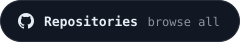
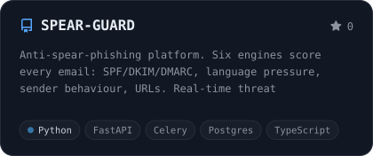
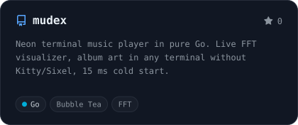
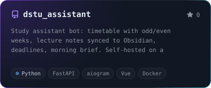
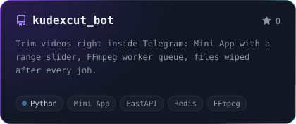
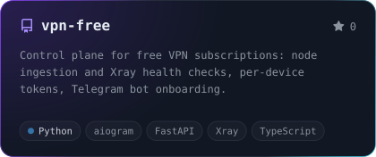
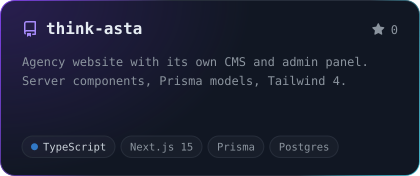
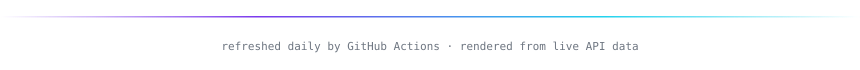

  

  &nbsp;
  &nbsp;
  

 

I'm a Python backend developer from Russia. I ship complete products around Telegram: the bot, the FastAPI backend, background workers, the database, and the Docker setup it all runs in.

<table>
  <tr>
    <td width="25%" valign="top"><b>Backend</b> FastAPI · SQLAlchemy · Celery · PostgreSQL · Redis</td>
    <td width="25%" valign="top"><b>Telegram</b> aiogram bots · Mini Apps · admin panels · subscription flows</td>
    <td width="25%" valign="top"><b>Frontend</b> TypeScript · React · Next.js · Vue · Tailwind</td>
    <td width="25%" valign="top"><b>Infra</b> Docker Compose · Nginx · Caddy · Linux servers · GitHub Actions</td>
  </tr>
</table>

## Featured work

  
  
  
  
  
  

## Toolbox

  

## Activity

  

  <picture>
    <source media="(prefers-color-scheme: dark)" srcset="https://raw.githubusercontent.com/sudxxt-afk/sudxxt-afk/output/snake-dark.svg" />
    <source media="(prefers-color-scheme: light)" srcset="https://raw.githubusercontent.com/sudxxt-afk/sudxxt-afk/output/snake.svg" />
    
  </picture>

  

