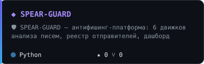
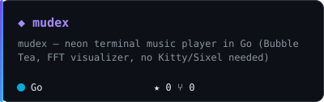
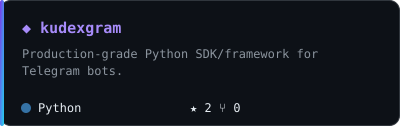
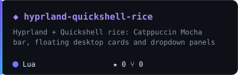
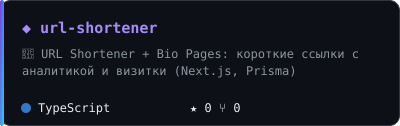
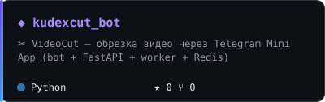

<p align="center">
  <a href="https://github.com/sudxxt-afk"></a>
</p>

<p align="center">
  <a href="https://github.com/sudxxt-afk?tab=followers"></a>
  <a href="https://t.me/defibrilla_tor"></a>
</p>

<br/>

## `~/about`

```python
kudesnik = {
    "role":     "Python Developer",
    "location": "Russia",
    "focus":    ["Telegram bots", "Backend (FastAPI)", "Fullstack mini-apps"],
    "daily":    ["Python", "FastAPI", "aiogram", "PostgreSQL", "Redis", "Docker"],
    "also":     ["TypeScript", "React", "Next.js"],
    "contact":  "https://t.me/defibrilla_tor",
}
```

<br/>

## `~/stack`

<p align="center">
  
</p>

<p align="center">
  
  
  
</p>

<br/>

## `~/projects`

<table align="center">
  <tr>
    <td><a href="https://github.com/sudxxt-afk/SPEAR-GUARD"></a></td>
    <td><a href="https://github.com/sudxxt-afk/mudex"></a></td>
  </tr>
  <tr>
    <td><a href="https://github.com/sudxxt-afk/kudexgram"></a></td>
    <td><a href="https://github.com/sudxxt-afk/hyprland-quickshell-rice"></a></td>
  </tr>
  <tr>
    <td><a href="https://github.com/sudxxt-afk/url-shortener"></a></td>
    <td><a href="https://github.com/sudxxt-afk/kudexcut_bot"></a></td>
  </tr>
</table>

<br/>

## `~/stats`

<p align="center">
  
</p>

<p align="center">
  
</p>

<p align="center">
  
</p>

<p align="center">
  <picture>
    <source media="(prefers-color-scheme: dark)" srcset="https://raw.githubusercontent.com/sudxxt-afk/sudxxt-afk/output/snake-dark.svg" />
    <source media="(prefers-color-scheme: light)" srcset="https://raw.githubusercontent.com/sudxxt-afk/sudxxt-afk/output/snake.svg" />
    
  </picture>
</p>

<br/>

## `~/contact`

<p align="center">
  <a href="https://t.me/defibrilla_tor"></a>
  <a href="mailto:sudxxt@gmail.com"></a>
  <a href="https://github.com/sudxxt-afk"></a>
</p>


